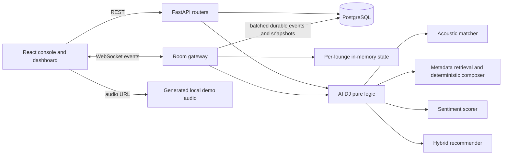
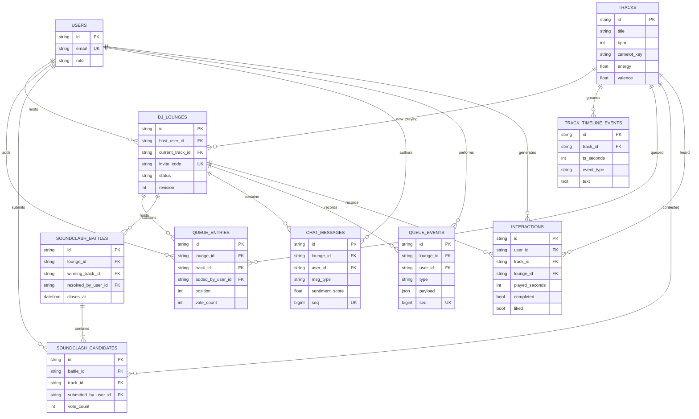

# Architecture and data model

AI DJ Studio is a single-process, full-stack Track A implementation using React/Vite,
FastAPI, and PostgreSQL. The API exposes OpenAPI documentation at `/docs`; the browser
uses REST for catalog and dashboard reads and one authenticated WebSocket per lounge
for live room state.

## Components and data flow

`backend/app/main.py` assembles the app, routers, health checks, media handler, and
room-registry lifecycle. `backend/app/api/` contains authenticated REST endpoints.
`backend/app/gateway/` owns connection handling, queue state, fan-out, chat, moderation,
and Soundclash. `backend/app/aijd/` contains the matching, grounding, segue, battle,
composition, and recommendation logic. `backend/app/analytics/` derives summaries from
the event log. The React panels are under `frontend/src/panels/` and the socket reducer
is under `frontend/src/state/`.

The matcher is kept free of database and gateway imports. The room registry is created
on FastAPI app state so async locks do not cross event loops. Each live room is
authoritative for frequent queue, presence, vote, and sentiment changes. Durable events
are appended in batches; queue and lounge state are restored from PostgreSQL when a room
is reopened. Chat messages have an append sequence for deterministic replay.

## Relational model

The shipped schema has ten tables. Foreign keys and check constraints are defined in
`backend/app/db/models.py` and applied through Alembic migrations.

Queue positions are sparse integers, so moving an item usually updates one row. The
append-only `queue_events` log supports session analytics and room recovery. `interactions`
stores listening exposure, completion, and likes used by the hybrid recommendation rail.

## Deliberate decisions and limits

- Track A uses a browser UI. Docker is omitted because PRD §4.1 allows a local setup.
- Audio is generated locally by `make media`; audio files are ignored by Git and must be
  generated after cloning.
- The composer uses deterministic, metadata-grounded templates instead of a hosted LLM.
  This avoids unsupported facts and is disclosed as a scope choice; see the retrospective.
- Open Soundclash battles and their current ballots are restored from PostgreSQL after restart.
  Changed ballots update the battle row directly; this favors restart durability over the normal
  batched queue-vote path. Unopened stage submissions and a resolved winner absent from the queue
  projection are not yet reconstructed.
- The current security scope is a single-operator local/private demo. The WebSocket JWT
  is passed in the query string and login rate limiting is not implemented; these must be
  addressed before a public production service.
